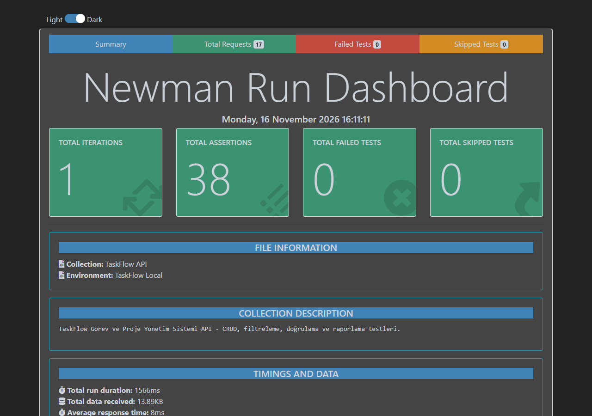

# TaskFlow API

🔗 **GitHub:** https://github.com/FFayken/TNC-Grup-Backend-Projesi

**Görev ve Proje Yönetim Sistemi** — Node.js + Express.js ile geliştirilmiş REST API.
Bir yazılım şirketinin ekip içindeki görevleri oluşturmasını, çalışanlara atamasını, durum ve önceliklerini takip etmesini ve temel raporlar almasını sağlar.



## Özellikler

| Kapsam | Özellik |
|---|---|
| Zorunlu | Görev **ekleme, listeleme, detay, güncelleme, silme** (CRUD) |
| Zorunlu | **Logger middleware** — her isteğin method, endpoint, zaman damgası, durum kodu ve süresi konsola ve `logs/requests.log` dosyasına yazılır |
| Zorunlu | Routing yapısı (`routes → controllers → services → data`) |
| Zorunlu | Postman koleksiyonu ve test ekran görüntüleri |
| İsteğe bağlı | Filtreleme (`status`, `priority`, `project`), arama, kullanıcı bazlı listeleme, sıralama, sayfalama |
| İsteğe bağlı | **Validation middleware** (`title`, `description`, `priority`, `assignee`) → hatalı veride `400 Bad Request` |
| İsteğe bağlı | Raporlama: `/reports/completed`, `/reports/pending`, `/reports/summary` |
| İsteğe bağlı | API dokümantasyonu: [`docs/API.md`](docs/API.md) |

## Gereksinimler

- [Node.js](https://nodejs.org) 18 veya üzeri (geliştirme: v24.19.0)
- npm (Node.js ile gelir)
- (Opsiyonel) [Postman](https://www.postman.com/downloads/) — koleksiyonu içe aktarıp elle test etmek için

## Kurulum ve Çalıştırma

```bash
# 1. Repoyu indirin
git clone https://github.com/FFayken/TNC-Grup-Backend-Projesi.git
cd TNC-Grup-Backend-Projesi

# 2. Bağımlılıkları kurun
npm install

# 3. Sunucuyu başlatın
npm start          # normal mod
npm run dev        # geliştirme modu (nodemon ile otomatik yeniden başlatma)
```

Sunucu varsayılan olarak **http://localhost:3000** adresinde çalışır. Farklı port için: `PORT=4000 npm start` (PowerShell: `$env:PORT=4000; npm start`).

### Verileri sıfırlama

Veriler `src/data/tasks.json` dosyasında tutulur (ilk çalıştırmada `seed-tasks.json`'dan oluşturulur). Başlangıç verisine dönmek için:

```bash
npm run seed
```

## Testler (Postman)

`postman/` klasöründe hazır koleksiyon ve ortam dosyası vardır.

**Postman uygulamasıyla:** Postman → *Import* → `postman/TaskFlow.postman_collection.json` ve `postman/TaskFlow.local.postman_environment.json` dosyalarını seçin, sağ üstten **TaskFlow Local** ortamını seçip istekleri sırayla çalıştırın (veya *Run collection*).

**Komut satırından (Newman — Postman'in CLI çalıştırıcısı):** sunucu çalışırken başka bir terminalde:

```bash
npm run seed
npm run test:postman
```

HTML rapor `docs/test-raporu.html` dosyasına yazılır. Son çalıştırma: **17 istek, 38 doğrulama, 0 hata.**
Ekran görüntüleri `screenshots/` klasöründedir.

## Endpoint Özeti

| Method | Endpoint | Açıklama |
|---|---|---|
| GET | `/tasks` | Tüm görevler (filtre: `status`, `priority`, `project`; `sort`, `page`, `limit`) |
| GET | `/tasks/:id` | Görev detayı |
| POST | `/tasks` | Yeni görev |
| PUT | `/tasks/:id` | Görevi tamamen güncelle |
| PATCH | `/tasks/:id` | Görevi kısmen güncelle (örn. sadece `status`) |
| DELETE | `/tasks/:id` | Görevi sil |
| GET | `/tasks/search?keyword=` | Başlık/açıklama/proje içinde arama |
| GET | `/tasks/assignee/:name` | Bir çalışana atanmış görevler |
| GET | `/reports/completed` | Tamamlanan görevler ve sayısı |
| GET | `/reports/pending` | Bekleyen görevler ve sayısı |
| GET | `/reports/summary` | Genel sistem özeti |

Ayrıntılar ve örnek istek/yanıtlar: [`docs/API.md`](docs/API.md)

## Klasör Yapısı

```
taskflow-api/
├── src/
│   ├── server.js              # Sunucuyu başlatır
│   ├── app.js                 # Express uygulaması, middleware ve rotalar
│   ├── routes/                # task.routes.js, report.routes.js
│   ├── controllers/           # İstek/yanıt mantığı
│   ├── services/              # İş mantığı (filtre, sıralama, CRUD)
│   ├── models/                # Görev veri modeli
│   ├── middlewares/           # logger, validateTask, notFound, errorHandler
│   └── data/                  # JSON veri deposu ve seed verisi
├── postman/                   # Postman koleksiyonu ve ortamı
├── docs/                      # Proje tanıtım dokümanı, API dokümanı, test raporu
├── screenshots/               # Test ekran görüntüleri
└── logs/                      # requests.log (otomatik oluşur)
```

## Proje Tanıtım Dokümanı

[`docs/PROJE_TANITIM.md`](docs/PROJE_TANITIM.md)
